## AI-Based Wholesale Salt Price Prediction and Market Trend Analysis Using Machine Learning

### 📌 Project Overview

The **AI-Based Wholesale Salt Price Prediction and Market Trend Analysis** project is a machine learning-based system designed to analyze historical wholesale salt prices, identify regional market trends, and forecast future price fluctuations using machine learning and optimization algorithms.

The project utilizes historical weekly wholesale prices of loose salt collected from different geographical zones and market centres.

The system implements **Random Forest Regression, Long Short-Term Memory (LSTM), Artificial Immune System (AIS), and Clonal Selection Optimization** to analyze historical price patterns and improve prediction performance.

The project also generates model evaluation graphs, correlation heatmaps, prediction results, and future price forecasting visualizations.

---

### 📊 Model Performance Visualization

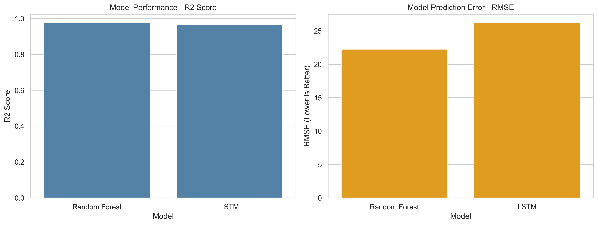

**Figure 1:** Performance comparison of Random Forest and LSTM models using R² Score and Root Mean Squared Error (RMSE).

The visualization helps evaluate model performance and identify which algorithm produces more accurate wholesale salt price predictions.

---

### 🎯 Project Objectives

The primary objectives of this project are:

1. Analyze historical wholesale salt price fluctuations.
2. Identify price trends across geographical zones and market centres.
3. Develop machine learning models for wholesale salt price prediction.
4. Implement deep learning models for historical price pattern analysis.
5. Optimize Random Forest hyperparameters using Artificial Immune System (AIS).
6. Apply Clonal Selection Algorithms for optimization.
7. Compare the performance of different prediction models.
8. Evaluate prediction performance using regression metrics.
9. Generate future wholesale salt price forecasts.
10. Visualize historical and predicted prices.

---

### 📂 Dataset Information

**Dataset Name:** Weekly Wholesale Price of Loose Salt up to 2012

**Dataset File:**

`weekly_wholesale_price_salt_loose_upto-2012.csv`

The dataset contains historical weekly wholesale salt prices recorded across different geographical zones and market centres.

#### Dataset Attributes

| Attribute | Description |
|-----------|-------------|
| Date | Date of the weekly price observation |
| zone | Geographical zone |
| centre | Market or reporting centre |
| salt_l | Wholesale price of loose salt |

#### Target Variable

`salt_l`

The target variable represents the wholesale price of loose salt.

#### Input Features

The machine learning models use:

- Year
- Month
- Week
- Quarter
- Geographical Zone
- Market Centre
- Previous Salt Prices
- Days Since Previous Observation

Historical lag features are generated to help models learn price fluctuations over time.

---

### 🛠️ Technologies Used

#### Programming Language

- Python

#### Libraries and Frameworks

- Pandas
- NumPy
- Scikit-learn
- TensorFlow
- Keras
- Matplotlib
- Seaborn
- Joblib
- PyYAML
- H5py

#### Development Environment

- Jupyter Notebook
- Visual Studio Code
- Python 3.x

---

### 🧠 Machine Learning Algorithms

#### 1. Random Forest Regressor

Random Forest is an ensemble machine learning algorithm that combines multiple decision trees to generate predictions.

It is used to predict wholesale salt prices based on historical observations, geographical information, and time-related features.

**Advantages:**

- Handles nonlinear relationships.
- Supports multiple input features.
- Reduces overfitting through ensemble learning.
- Performs well on structured datasets.

#### 2. Long Short-Term Memory (LSTM)

LSTM is a recurrent neural network architecture designed to learn patterns from sequential data.

In this project, LSTM analyzes historical salt price sequences to predict future price values.

**Advantages:**

- Learns temporal relationships.
- Processes sequential observations.
- Captures historical price patterns.
- Supports time-series forecasting.

#### 3. Artificial Immune System (AIS)

Artificial Immune System is a biologically inspired optimization technique based on the principles of the human immune system.

The project implements an AIS-based Clonal Selection Algorithm to optimize Random Forest hyperparameters.

AIS performs the following operations:

1. Generate an initial population of candidate solutions.
2. Evaluate candidate solutions using validation RMSE.
3. Select high-performing candidates.
4. Clone selected candidates.
5. Apply mutation to explore new solutions.
6. Preserve the best solutions.
7. Repeat optimization for multiple generations.

#### 4. Clonal Selection Algorithm

The Clonal Selection Algorithm is used to improve the quality of candidate solutions during AIS optimization.

Each candidate solution represents a combination of Random Forest hyperparameters.

The optimization process searches for improved values of:

- Number of estimators
- Maximum tree depth
- Minimum samples required for splitting
- Minimum samples per leaf
- Maximum features considered

The best hyperparameter combination is selected based on validation performance.

#### 5. AIS-Configured Neural Network

The project also implements a feedforward neural network whose hidden-layer size is configured using a heuristic derived from an AIS-selected Random Forest parameter.

This model is compared with the AIS-optimized Random Forest.

The neural network is not independently optimized using AIS.

---

### ⚙️ Project Workflow

The complete machine learning workflow consists of the following stages:

**Step 1: Dataset Collection**

Load historical wholesale salt price records from the CSV dataset.

**Step 2: Data Preprocessing**

Perform data cleaning operations:

- Handle missing values.
- Remove invalid records.
- Convert date columns.
- Process categorical features.
- Remove invalid price observations.
- Aggregate duplicate market-date records.

**Step 3: Feature Engineering**

Generate additional features:

- Year
- Month
- Week
- Quarter
- Historical price lags
- Days since previous observation

**Step 4: Data Splitting**

Divide the dataset chronologically into training, validation, and testing periods.

**Step 5: Model Training**

Train Random Forest and LSTM models using historical wholesale salt price information.

**Step 6: AIS Optimization**

Apply the Clonal Selection Algorithm to optimize Random Forest hyperparameters.

**Step 7: Model Evaluation**

Evaluate prediction performance using regression metrics.

**Step 8: Price Forecasting**

Generate experimental future wholesale salt price forecasts.

**Step 9: Visualization**

Generate and save model evaluation graphs, heatmaps, comparison graphs, and prediction visualizations.

**Step 10: Model Export**

Save trained models and configuration files for future use.

---

### 📐 Model Evaluation Metrics

The project evaluates prediction performance using the following metrics.

#### Mean Absolute Error (MAE)

MAE measures the average absolute difference between actual and predicted values.

MAE = (1/n) × Σ|Actual - Predicted|

Lower MAE indicates better prediction performance.

#### Mean Squared Error (MSE)

MSE measures the average squared difference between actual and predicted values.

MSE = (1/n) × Σ(Actual - Predicted)²

Lower MSE indicates smaller prediction errors.

#### Root Mean Squared Error (RMSE)

RMSE is the square root of Mean Squared Error.

RMSE = √MSE

Lower RMSE indicates better prediction performance.

#### R² Score

R² measures how well the regression model explains variation in the target variable.

R² = 1 - (SS_res / SS_tot)

Higher R² generally indicates better model performance.

An R² score can also be negative when the model performs worse than a constant-mean baseline.

---

### 📈 Generated Visualizations

The project generates the following visualizations.

#### 1. Model Performance Graph


Displays Random Forest and LSTM performance using R² and RMSE.

#### 2. Correlation Heatmap

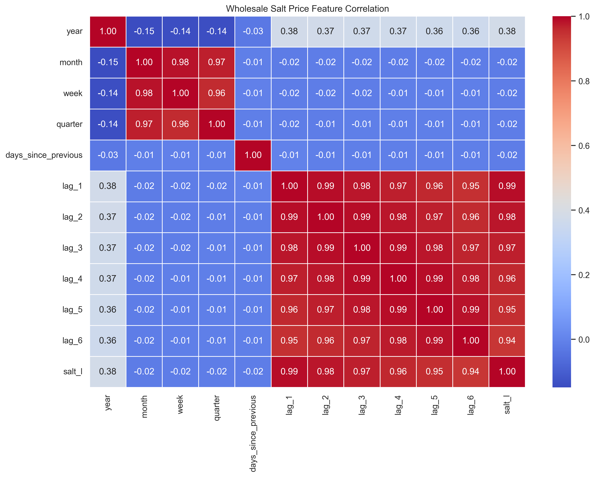

Displays correlations between numerical features and wholesale salt prices.

#### 3. Model Comparison Graph

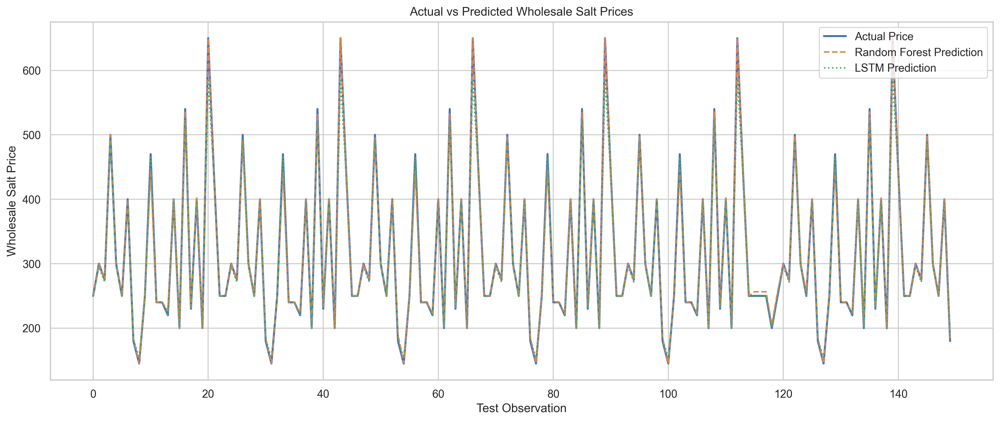

Compares actual wholesale salt prices with Random Forest and LSTM predictions.

#### 4. Result Graph

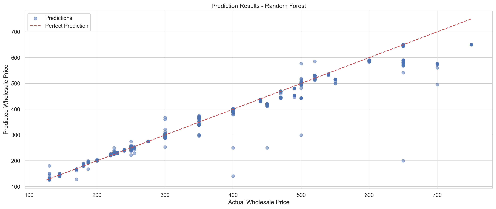

Displays actual versus predicted wholesale salt prices.

#### 5. Future Prediction Graph

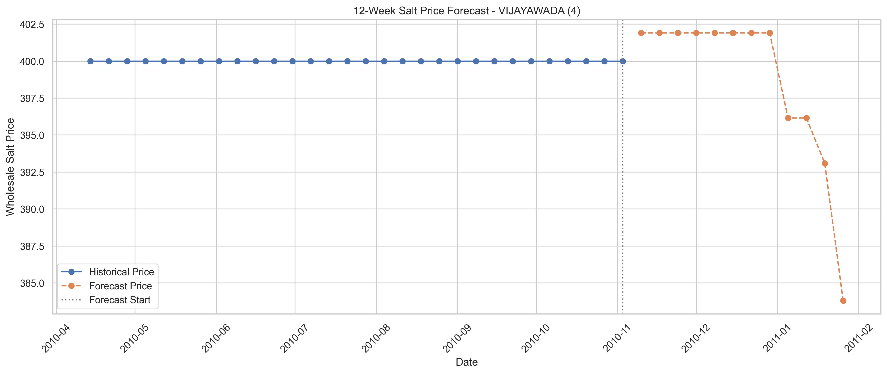

Displays historical wholesale salt prices and experimental future price forecasts.

#### 6. LSTM Training Loss Graph

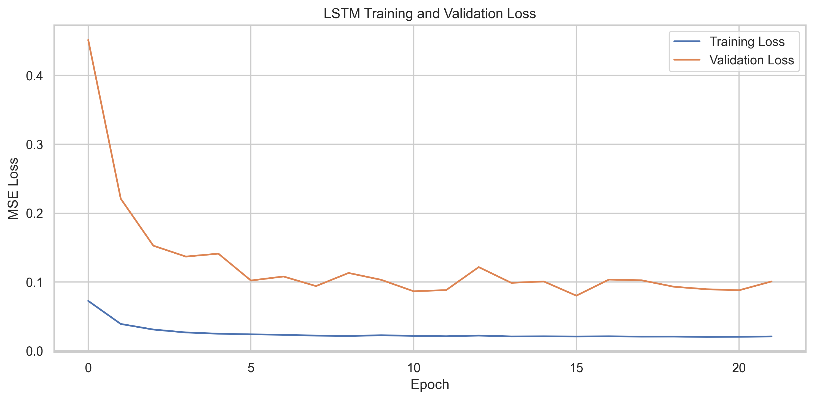

Displays training and validation loss across epochs.

---

### 🧬 AIS Optimization Visualizations

#### AIS Model Performance

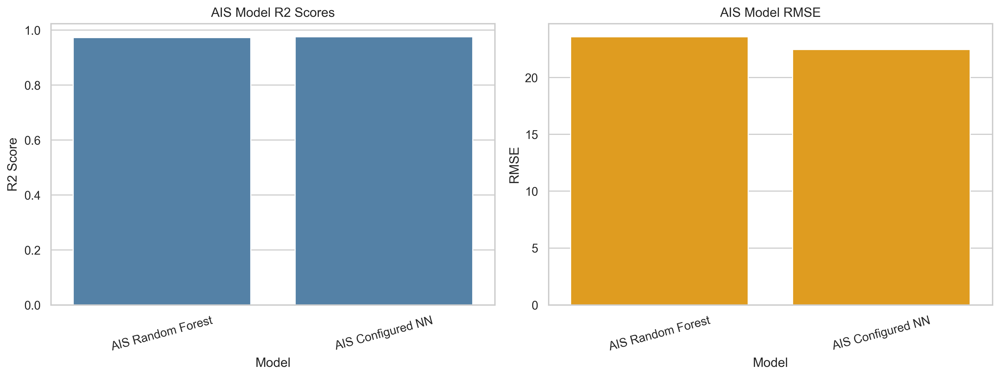

Compares the AIS-optimized Random Forest and AIS-configured neural network.

#### AIS Correlation Heatmap

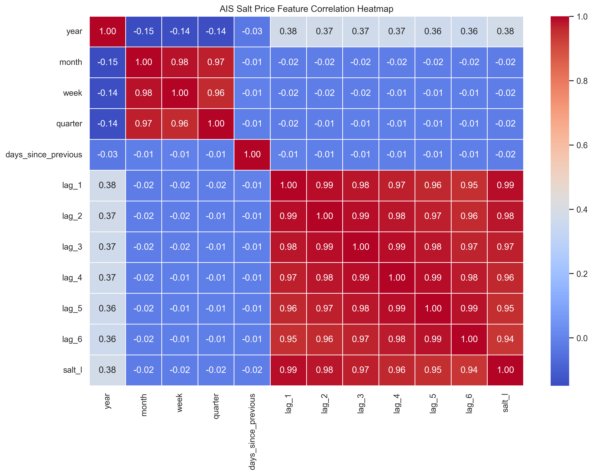

Displays correlations between historical price features.

#### AIS Model Comparison

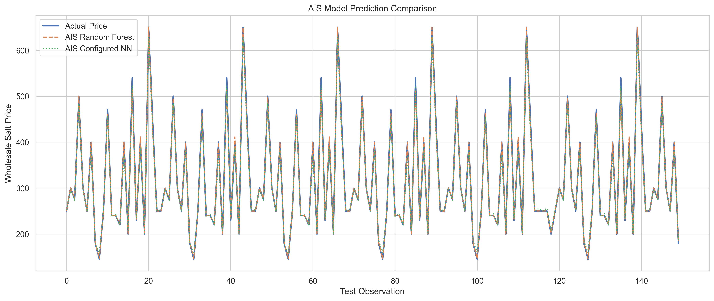

Compares actual prices with predictions generated by the AIS models.

#### AIS Optimization Progress

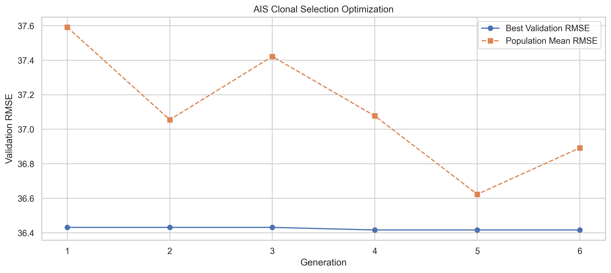

Displays validation RMSE across AIS generations.

#### AIS Prediction Results

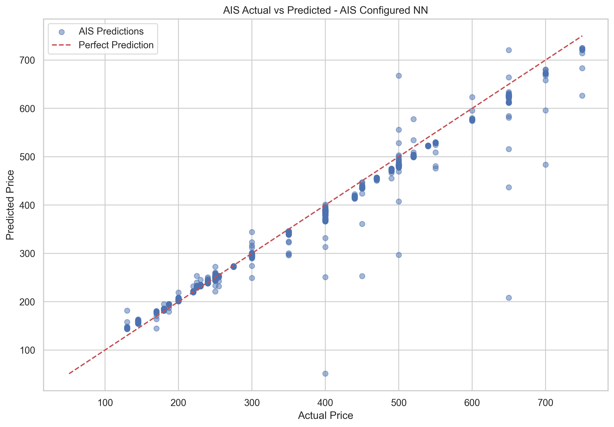

Displays actual versus predicted wholesale salt prices.

#### AIS Future Forecast

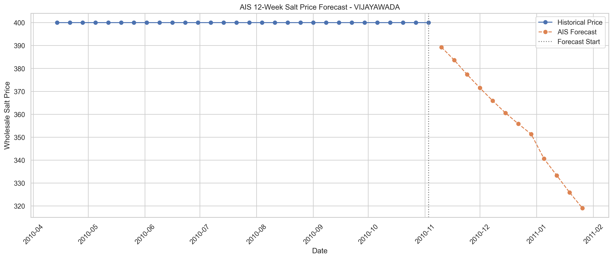

Displays historical prices and future forecasts generated using the selected AIS model.

#### AIS Neural Network Training Loss

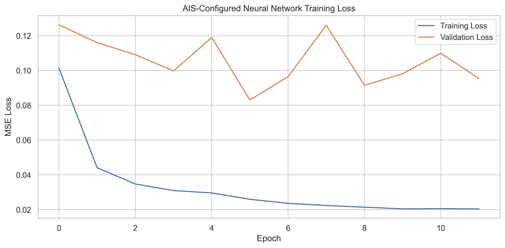

Displays training and validation loss of the AIS-configured neural network.

---

### 📁 Project Directory Structure

```text
AI-Based Wholesale Salt Price Prediction and Market Trend Analysis/
│
├── weekly_wholesale_price_salt_loose_upto-2012.csv
│
├── salt_price_analysis.py
├── ais_salt_price_analysis.py
│
├── salt_price_model.pkl
├── salt_price_model.h5
├── lstm_scaler.pkl
│
├── config.yaml
├── model_metadata.json
├── model_comparison.csv
│
├── accuracy_graph.png
├── heatmap.png
├── comparison_graph.png
├── result.csv
├── result_graph.png
├── prediction.csv
├── prediction_graph.png
├── training_loss_graph.png
│
├── ais_salt_price_model.pkl
├── ais_salt_price_model.h5
├── ais_nn_scaler.pkl
│
├── ais_config.yaml
├── ais_model_metadata.json
├── ais_model_comparison.csv
├── ais_optimization_history.csv
│
├── ais_accuracy_graph.png
├── ais_heatmap.png
├── ais_comparison_graph.png
├── ais_result.csv
├── ais_result_graph.png
├── ais_prediction.csv
├── ais_prediction_graph.png
├── ais_optimization_graph.png
├── ais_training_loss_graph.png
│
└── README.md
```

---

### 💻 Installation and Setup

#### Step 1: Clone the Repository

```bash
git clone https://github.com/YOUR_USERNAME/YOUR_REPOSITORY.git
```

Replace the placeholder with your actual GitHub repository URL.

#### Step 2: Navigate to the Project Directory

```bash
cd "AI-Based Wholesale Salt Price Prediction and Market Trend Analysis"
```

#### Step 3: Install Required Libraries

```bash
pip install pandas numpy scikit-learn tensorflow matplotlib seaborn joblib pyyaml h5py
```

#### Step 4: Configure Dataset Path

Open the Python scripts and update the dataset directory if necessary.

```python
from pathlib import Path

BASE_DIR = Path(
    r"C:\Users\sagni\Downloads\AI-Based Wholesale Salt Price Prediction and Market Trend Analysis"
)

DATA_PATH = BASE_DIR / "weekly_wholesale_price_salt_loose_upto-2012.csv"
```

#### Step 5: Run the Machine Learning Model

```bash
python salt_price_analysis.py
```

This script trains Random Forest and LSTM models and generates evaluation graphs, result files, and forecasts.

#### Step 6: Run AIS Optimization

```bash
python ais_salt_price_analysis.py
```

This script executes AIS-based optimization and generates files beginning with the `ais_` prefix.

---

### 📊 Prediction Results

The project generates CSV files containing actual and predicted wholesale salt prices.

#### Standard Model Results

**File:** `result.csv`

Contains:

- Date
- Zone
- Centre
- Actual Price
- Random Forest Predicted Price
- LSTM Predicted Price
- Best Model Prediction
- Absolute Error
- Squared Error

#### AIS Model Results

**File:** `ais_result.csv`

Contains:

- Date
- Zone
- Centre
- Actual Price
- AIS Random Forest Prediction
- AIS Neural Network Prediction
- Best Model Prediction
- Absolute Error
- Squared Error

These results support model comparison and error analysis.

---

### 🔮 Future Price Prediction

The system generates experimental forecasts for the next 12 weekly periods following the final historical observation available for each market.

#### Standard Forecast

**File:** `prediction.csv`

Contains:

- Zone
- Centre
- Forecast Date
- Forecast Week
- Predicted Price
- Model

#### AIS Forecast

**File:** `ais_prediction.csv`

Contains:

- Zone
- Centre
- Forecast Date
- Forecast Week
- AIS Predicted Price
- Model

The forecasts are generated recursively using previous observed or predicted price values.

**Important:** Because the dataset contains historical information up to 2012, these forecasts do not represent current market prices.

---

### 💾 Saved Machine Learning Models

The project exports trained models and supporting files.

| File | Description |
|------|-------------|
| salt_price_model.pkl | Trained Random Forest model |
| salt_price_model.h5 | Trained LSTM model |
| lstm_scaler.pkl | LSTM price scaler |
| config.yaml | Model configuration |
| model_metadata.json | Model evaluation metadata |
| ais_salt_price_model.pkl | AIS-optimized Random Forest |
| ais_salt_price_model.h5 | AIS-configured neural network |
| ais_nn_scaler.pkl | Neural network preprocessing objects |
| ais_config.yaml | AIS configuration |
| ais_model_metadata.json | AIS evaluation metadata |

The saved models can be loaded for future inference and additional experimentation.

---

### 🔬 Experimental Methodology

The project follows a time-based machine learning evaluation approach.

1. Historical price records are cleaned and sorted.
2. Lag features are generated using previous observations from the same market.
3. Data is divided chronologically into training and testing periods.
4. AIS optimization uses a separate validation period.
5. Final models are evaluated using held-out test observations.
6. Predictions are compared using MAE, MSE, RMSE, and R².
7. Experimental forecasts are generated using recursive prediction.

This approach helps reduce temporal data leakage.

However, selecting the final model based on test-set performance introduces model-selection bias. For a stricter experimental evaluation, the final model should be selected using validation data before evaluating it once on the test set.

---

### 📉 Limitations

The project has several limitations:

- The dataset contains historical records only up to 2012.
- Some historical price observations are missing.
- Historical lag features may represent irregular observation intervals.
- External factors such as inflation, transportation costs, weather, and supply-chain disruptions are not included.
- Recursive forecasting errors may accumulate over longer horizons.
- The AIS optimization process can be computationally expensive.
- The AIS-configured neural network is not independently optimized using AIS.
- Historical forecasting performance does not guarantee reliable predictions for current markets.

---

### 🚀 Future Enhancements

Potential improvements include:

1. Integrating updated wholesale commodity price datasets.
2. Implementing Particle Swarm Optimization (PSO).
3. Comparing AIS and PSO optimization performance.
4. Developing a Streamlit-based prediction dashboard.
5. Incorporating inflation and transportation-cost information.
6. Adding seasonal trend analysis.
7. Implementing GRU and Transformer-based forecasting models.
8. Performing rolling-window time-series cross-validation.
9. Adding uncertainty intervals to price forecasts.
10. Deploying the trained models as a web application.

---

### 🌍 Applications

The project may support:

- Agricultural commodity price research
- Wholesale market trend analysis
- Historical commodity price forecasting
- Regional price comparison
- Supply-chain analytics
- Machine learning research
- Academic demonstrations of optimization algorithms

---

### 📚 Conclusion

The **AI-Based Wholesale Salt Price Prediction and Market Trend Analysis** project demonstrates the application of machine learning, deep learning, and biologically inspired optimization techniques to historical commodity price analysis.

Random Forest and LSTM models provide baseline predictions, while the Artificial Immune System applies clonal selection to optimize Random Forest hyperparameters.

The project generates model performance metrics, correlation heatmaps, prediction comparisons, historical test results, and experimental future forecasts.

The resulting framework provides a foundation for further research into commodity price prediction, time-series forecasting, and optimization-based machine learning.

---

### 📝 License

This project is intended for educational, academic, and research purposes.

Dataset usage and redistribution should comply with the original dataset provider's terms.

---

### ⭐ Acknowledgment

This project was developed to explore the application of machine learning and optimization algorithms in wholesale commodity price forecasting.

The implementation demonstrates how historical market information can be processed, analyzed, and used to build predictive models.

---

**Project Title:** AI-Based Wholesale Salt Price Prediction and Market Trend Analysis Using Machine Learning

**Domain:** Machine Learning | Deep Learning | Time-Series Forecasting | Optimization

**Programming Language:** Python

**Algorithms:** Random Forest | LSTM | Artificial Immune System | Clonal Selection

**Dataset:** Weekly Wholesale Price of Loose Salt up to 2012
